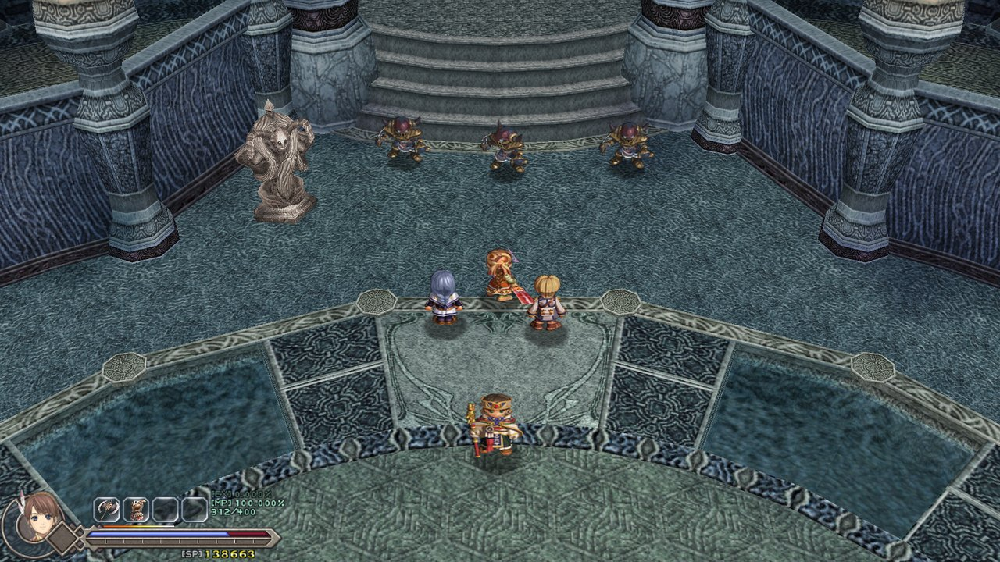
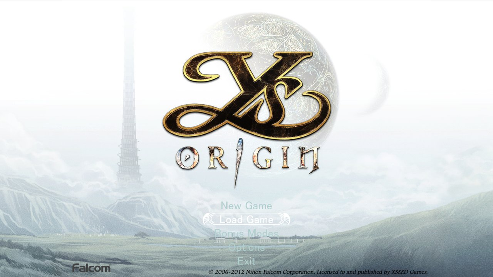
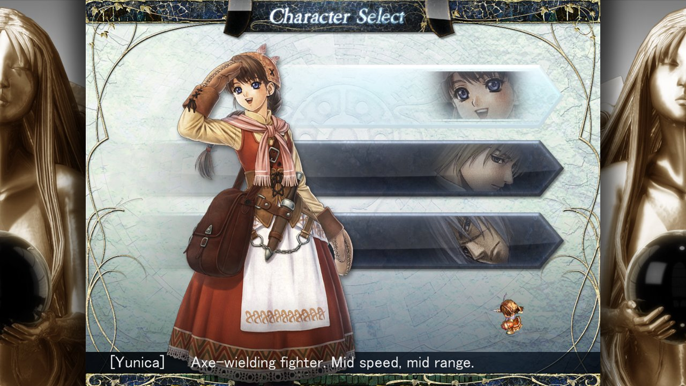
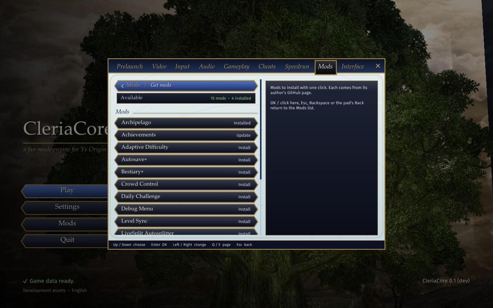

# CleriaCore

**Ys Origin, rebuilt as a modern native engine.**

Play your own copy of Ys Origin in any resolution and at any frame rate, on Windows, Linux or macOS, with
mods, a speedrun timer and quality-of-life options the original never had.

CleriaCore is a fan-made engine for **Ys Origin** (Nihon Falcom, 2006), in the spirit of devilutionX for
Diablo and OpenRCT2 for RollerCoaster Tycoon. It reads the game files of the copy you own and plays them with
code rewritten from scratch: the same rooms, monsters, bosses, menus and music, the same numbers, on a
renderer and a shell made for today's PCs.

It is not made, endorsed or supported by Nihon Falcom or XSEED, and it contains none of the game's files.

## ✨ Highlights

- **The real game, faithfully.** Every room, camera, cutscene script, monster and boss runs from the game's
  own data, with its damage formula, stats and drop tables. Defaults look and play like the original.
- **Modern display.** Any resolution and aspect ratio (ultrawide shows more, it does not stretch), a frame
  rate decoupled from the game's 60 Hz logic, a frame limiter, render scale up to 2× supersampling, and
  borderless fullscreen.
- **Mods built in.** Double-click a `.cleriamod` to install it, then turn mods on and off, reorder them and
  change their settings from **F1 > Mods**. Mods can reskin the game, change items and chests, or run Lua
  scripts.
- **Archipelago.** The [Archipelago mod](https://github.com/4rtefakt/ys-origin-cleriacore-ap) puts Ys Origin
  in a multiworld randomizer with other games.
- **Speedrun mode.** RTA and in-game timers, auto-splits, personal bests and a LiveSplit connection, plus an
  on-screen list of any non-original option in use.
- **Assists, if you want them.** Cutscene skip, damage and EXP multipliers, and other options under
  Gameplay and Cheats, all off by default and each labelled "Not a retail option".
- **Your controls.** Keyboard, mouse and gamepad, with the original's own presets and full rebinding.

<table>
  <tr>
    <td></td>
    <td></td>
  </tr>
  <tr>
    <td align="center">The title screen</td>
    <td align="center">Yunica, Hugo or Toal</td>
  </tr>
</table>

## 🚀 Getting started

> **CleriaCore is in early access.** The story is playable for all three characters; the post-game modes are
> not in yet (see [What's missing](#-whats-missing)).

### 📦 Download

Get the package for your system from the newest release on the [Releases page](https://github.com/4rtefakt/YsOrigin-CleriaCore/releases).
None of them contains any game files: CleriaCore uses your own copy of Ys Origin.

| System | Package | What to do |
|---|---|---|
| 🪟 **Windows 10/11** (64-bit) | `CleriaCore-<version>-windows-x64.zip` | Unzip anywhere and run `cleria-view.exe`. Windows may warn about an unrecognized app the first time: click **More info**, then **Run anyway**. |
| 🐧 **Linux and Steam Deck** (x86-64) | `CleriaCore-<version>-linux-x64.tar.gz` | Extract it and run `./cleria-view`. Works on any distribution from 2022 on. On the Steam Deck, add it to Steam as a non-Steam game to play in Game Mode. |
| 🍎 **macOS 11 or later** (Apple Silicon) | `CleriaCore-<version>-macos-arm64.zip` | Unzip and drag **CleriaCore** to Applications. The first time, macOS blocks it: open **System Settings > Privacy & Security** and click **Open Anyway**. |

Each package has a `FIRST-RUN.txt` with these steps in more detail. If you'd rather build it yourself, see
[docs/DEVELOPMENT.md](docs/DEVELOPMENT.md).

### ▶️ First run

1. **Own Ys Origin on Steam** and have it installed. CleriaCore only reads it, never changes it.
2. **Start CleriaCore.** The first time, it shows the Ys Origin installs it found in your Steam
   libraries. Pick yours (or browse to the folder) and it unpacks the game data once, in about 20 seconds.
3. **Play.** You land on the title screen. Press **F1** at any time for the settings and mods.

Your settings, saves and mods live in `Saved Games\CleriaCore` on Windows, `~/.config/CleriaCore` on Linux
and `~/Library/Application Support/CleriaCore` on macOS. Your original Ys Origin saves are left alone.

## 🎮 Controls

CleriaCore uses the original game's key bindings. If you played Ys Origin before, your own bindings are
imported the first time. Everything can be rebound under **F1 > Input**.

| Action | Keyboard (default) | Keyboard (preset 2) | Gamepad |
|---|---|---|---|
| Move | Arrows, numpad 1–9 | W A S D | Left stick, d-pad |
| Attack, talk, open, OK | **Z** | **.** or left click | A |
| Jump, Cancel | **X** or right click | **/** or right click | B |
| Magic | C | middle click | X |
| Boost | V | Space | Y |
| Menu (the book) | Space or **Esc** | Tab or **Esc** | Right stick click |
| Walk (hold) | Left Shift | Left Shift | Left stick click |
| Settings and mods | **F1** | **F1** | |

To skip a cutscene, press the menu button twice. **F1 > Gameplay > Cutscenes** changes that to a single
press, a hold, always or never.

## 🧩 Mods

 Mods > Get mods, the list of mods to install with one click" width="720">

- **Get mods**: press **Mods** on the launcher (or **F1 > Mods**), then **Get mods**. Pick a mod and it is
  downloaded, installed and turned on; restart CleriaCore to play with it. Achievements, New Game+, a solo
  randomizer, Archipelago and more are a click away, on Windows, Linux and macOS alike.
- **Updates**: CleriaCore checks your mods for new versions when you open the Mods tab. A mod with an update
  shows its new version in gold; **Update** takes it, keeping your settings and the mod on or off as it was.
- **Install a file**: double-click a `.cleriamod` file, drop it on the CleriaCore window, or use
  **F1 > Mods > Install a mod file...**.
- **Manage**: **F1 > Mods** lists your mods. Turn each on or off, move it up or down (lower in the list wins
  when two mods change the same thing), open its page for its own settings, or remove it (it goes to the
  Recycle Bin or the Trash).
- **Make your own**: [samples/mods/README.md](samples/mods/README.md) is the guide, with four sample mods
  from a simple reskin to the full Archipelago client.

Mods made for CleriaCore also run in the original Steam game through
**[CleriaOre](https://github.com/4rtefakt/CleriaOre)**, CleriaCore's mod loader for the retail game.

## 🧭 What's missing

CleriaCore is honest about what is not there yet:

- **The post-game**: Time Attack, the Arena, the Bonus Shop and Adol are not playable yet.
- **Small differences from the original** remain in places, from effects that are simplified to numbers
  that are approximated. They are being tracked down one by one.
- **Linux and macOS** builds work but are less tested than Windows.

If you find something that behaves differently from the original game, please open an issue and say what
you expected to see.

## 🔬 For the curious

Everything CleriaCore knows about the game was worked out from the original program, function by function.
That research lives in the **[yso](https://github.com/4rtefakt/yso)** repository: notes on every part of the
game, its file formats, and how much of it is covered. Building, the code layout and the list of known
stand-ins are in [docs/DEVELOPMENT.md](docs/DEVELOPMENT.md).

## 🙏 Credits

- **Ys Origin** is © Nihon Falcom Corporation, published in English by XSEED Games. Please buy it: CleriaCore
  needs your copy to run.
- Built on the reverse-engineering foundation of the
  [Ys Origin Archipelago](https://github.com/4rtefakt/ys-origin-archipelago) project (the archive cipher, the
  event script VM, the item and scene maps).
- Libraries: [SDL3](https://libsdl.org), [wgpu-native](https://github.com/gfx-rs/wgpu-native),
  [Dear ImGui](https://github.com/ocornut/imgui), [Lua](https://www.lua.org),
  [miniz](https://github.com/richgel999/miniz) and [stb_vorbis](https://github.com/nothings/stb).
